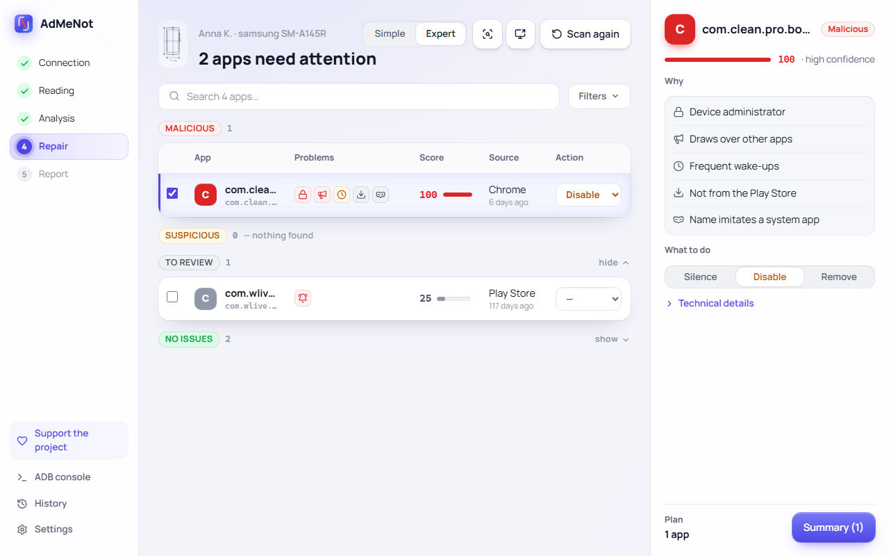
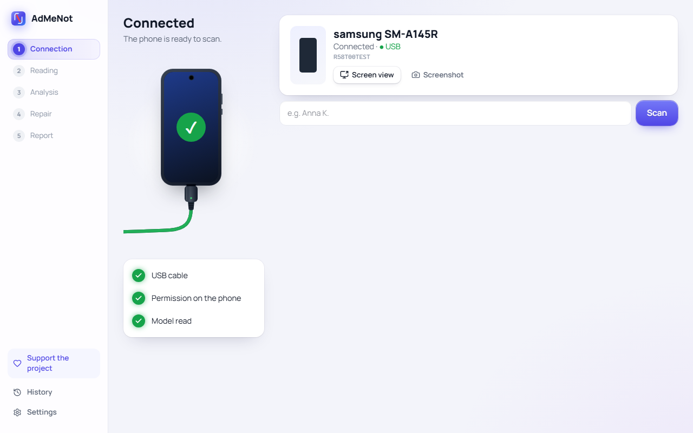
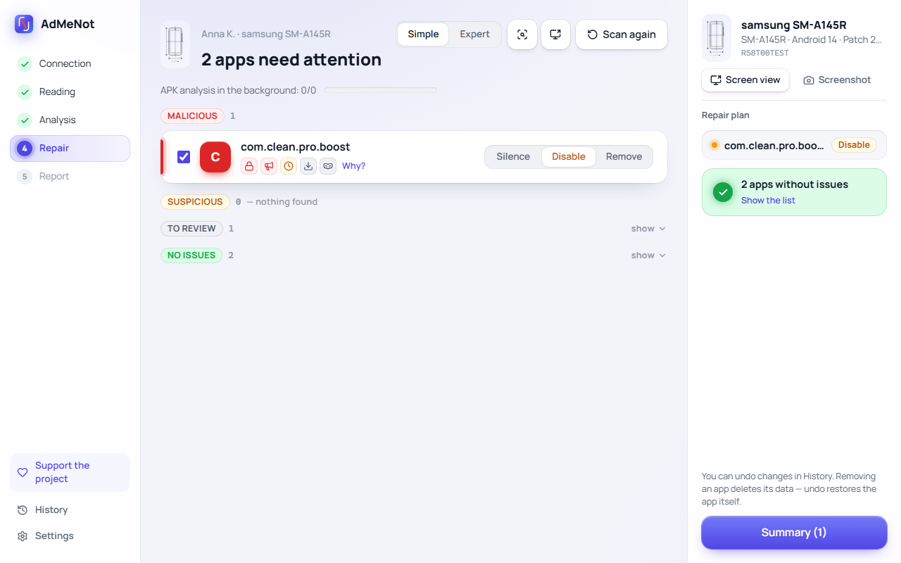
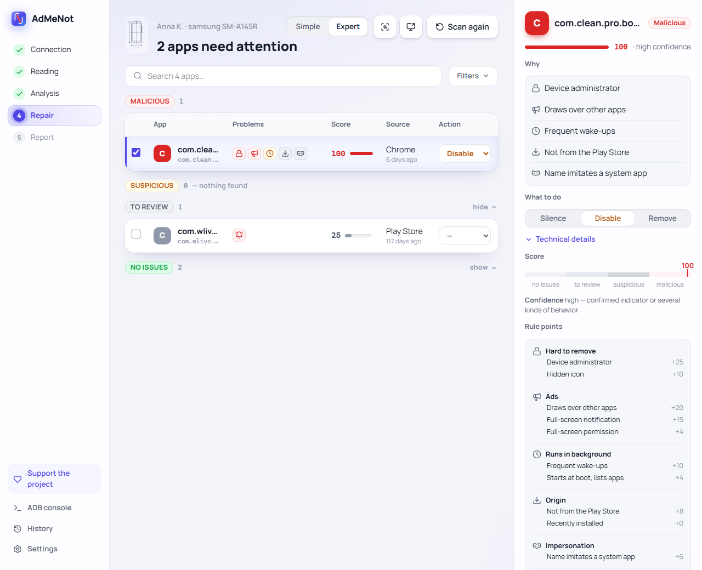
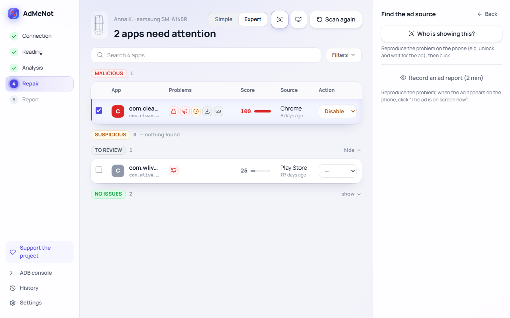
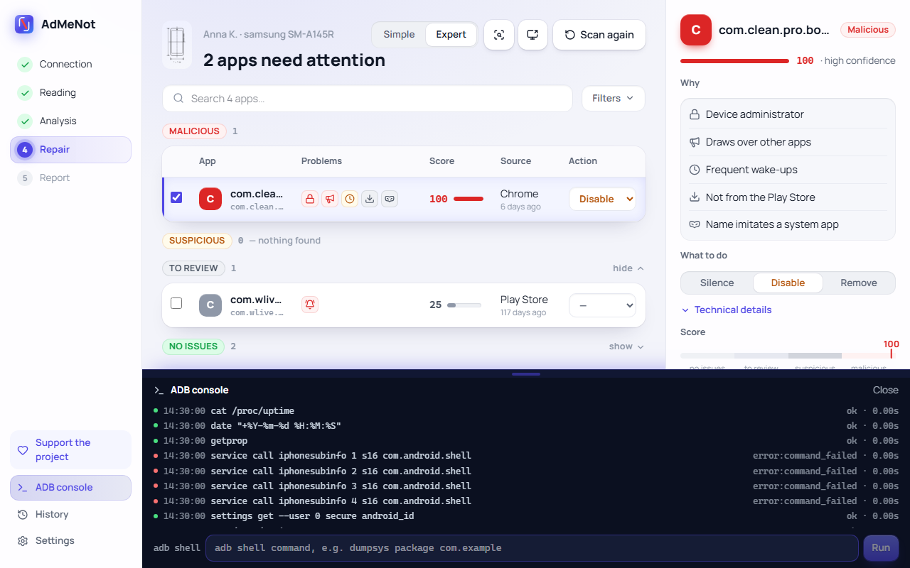
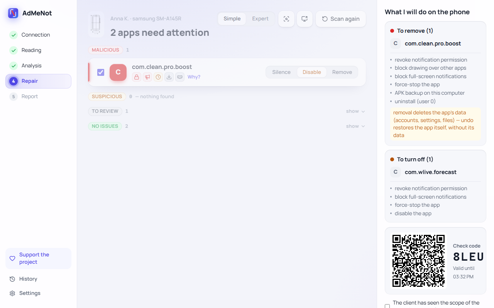
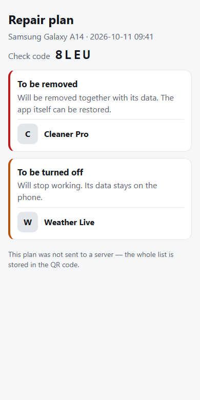
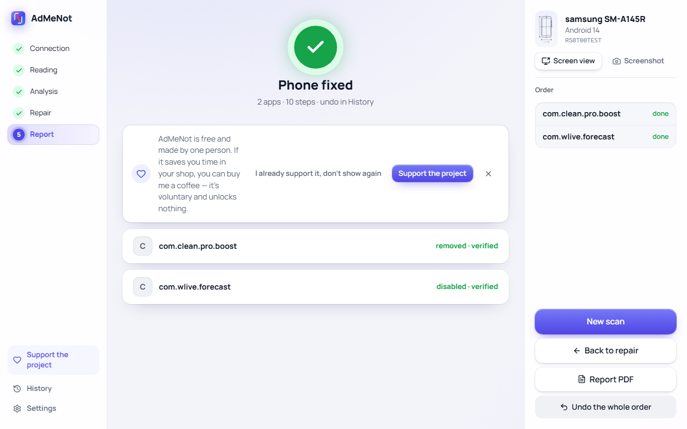
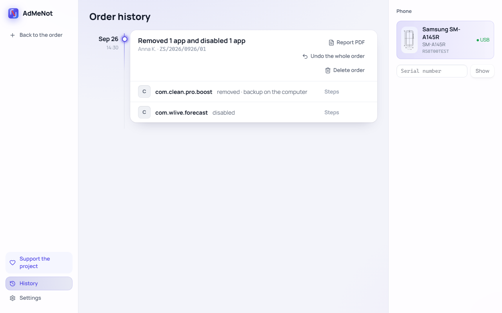

<h1>&nbsp;AdMeNot</h1>

**English** | [Polski](README.pl.md)

**A free Windows tool for phone repair shops that removes adware from Android phones.** Connect a phone over USB: AdMeNot finds the apps that show ads over other apps, flood the phone with notifications or hide from removal, explains why each one was flagged, and mutes, disables or removes them — with undo.

[Download for Windows](https://github.com/PerlessMtFuji/AdMeNot/releases/latest) · [Website](https://admenot.perlessmtfuji.workers.dev/) · [Support the project](https://suppi.pl/perlessmtfuji)

<picture>
  <source media="(prefers-color-scheme: dark)" srcset="docs/img/en/results-expert-dark.png">
  
</picture>

> Public beta. The ratings are heuristic: they say what an app does and how sure the program is, not that it is malware. The technician makes the final call — read [False positives](#false-positives) before relying on them.

## Contents

- [What it does](#what-it-does)
- [How apps are rated](#how-apps-are-rated)
- [False positives](#false-positives)
- [Installation](#installation)
- [Development](#development)
- [Support](#support) · [License](#license)

## What it does

### Connect and scan

Plug in a phone with USB debugging on. AdMeNot recognizes the model (with a photo from its phone database), reads the installed apps and what they did on the phone in the last 24 hours, then — in the background — copies and analyzes the APK files of user apps. Nothing on the phone is changed during a scan.

 

### Results in two modes

- **Simple** — apps grouped as *Malicious*, *Suspicious*, *To review* and *No issues*, each with icons for its problems and a plain-language “Why?”.
- **Expert** — a table with score, install source and age, search and filters, plus the full list of rule points and confidence for each app.

### Find the ad source

When the customer says “ads pop up”, but the culprit is not obvious, reproduce the problem on the phone and click **Who is showing this?** — AdMeNot reads which app owns the window on screen. **Record an ad report** watches the phone for two minutes; you click when the ad appears, and the app behind it gets an extra signal in the rating. The screen can be mirrored on the computer (scrcpy) and screenshots attached to the order.

 

The **ADB console** shows every command the program sends to the phone.

### Repair plan, shown to the client

Each app gets one of three levels: **Silence** (revoke notifications, block drawing over other apps and full-screen notifications), **Disable** (also stop and turn the app off), or **Remove** (APK backup on the computer, then uninstall). The summary lists every step before anything runs. **Show the client** puts the plan in a QR code with a check code: the client opens it on their own phone, and the same code is visible on the technician's screen.

 

The plan is stored encrypted on the AdMeNot server for one hour and only the key inside the QR code can decrypt it; without internet, the whole plan goes into the QR code itself.

### Repair, report and undo

AdMeNot runs the steps and verifies each one. Device administrators need one tap on the phone — the program says which. If the cable comes out mid-repair, reconnect the phone and the order can be finished or undone. The finished order gets a PDF service report with the shop's name, logo and screenshots.

 

Every change can be undone from **History**: a disabled or silenced app returns to its previous state, a removed app is reinstalled from the backup. Removing an app deletes its data (accounts, settings, files) — undo brings back the app itself, not its data.

### Also

- Polish and English, light and dark theme (following Windows).
- Protected system apps (Settings, phone, system UI, installer…) are locked — expert mode unlocks one only after typing its package name. The active keyboard can be silenced but not disabled, and a launcher is replaced only by the manufacturer's own one.
- Updates are checked automatically; anonymous usage statistics are off unless you opt in on first start.

## How apps are rated

Each app gets a **score from 0 to 100** and a **confidence** (low / medium / high). Both together decide the verdict. The rules live in [`rules.yaml`](src/admenot/engine/rules/data/rules.yaml) and [`python_rules.py`](src/admenot/engine/rules/python_rules.py), the arithmetic in [`scoring.py`](src/admenot/engine/scoring.py). Numbers below are from version 0.9.2.

### 1. Signals

A signal is a rule that matched. Every signal belongs to one **class** and has a basis — how strong the evidence is: the app *declares* something in its package, has a *code path* for it, was *granted* access, was *observed* doing it on this phone, or matches a *confirmed* threat indicator.

**Behavior** — observed on the phone in the last 24 hours (usage stats, app ops, notifications, alarms):

| Rule | Signal | Points |
|---|---|---|
| DM-NOTIF-01 | 8–19 interruptive notifications per hour (sound, vibration or heads-up) | 15 |
| DM-NOTIF-02 | 20 or more per hour | 25 |
| DM-NOTIF-03 | burst: 30+ in one hour, while the daily average is low | 15 |
| DM-OVERLAY-01 | drew over other apps in the last 24 h | 20 |
| DM-FSI-01 | posted a full-screen notification | 15 |
| DM-ALARM-01 | wakes the phone 6+ times per hour (user apps) | 10 |
| DM-BGACT-01 | came to the front right after unlocking, 3+ times in 24 h | 12 |
| DM-INCIDENT-01 | owned the window when the technician marked an ad | 5 |

**Position** — access that makes an app powerful or hard to remove:

| Rule | Signal | Points |
|---|---|---|
| DM-ADMIN-01 | device administrator | 25 |
| DM-A11Y-01 | accessibility service enabled | 20 |
| DM-NLS-01 | reads notifications | 10 |
| DM-HIDDEN-01 | no launcher icon (user apps) | 10 |

**Context** — origin and declarations (user apps):

| Rule | Signal | Points |
|---|---|---|
| DM-SRC-01 | not installed from the Play Store | 8 |
| DM-HOME-01 / 02 | is the home screen / can replace it | 8 / 4 |
| DM-SMS-01, DM-BROWSER-01 | default SMS app / default browser | 8 / 4 |
| DM-LABEL-01 | invisible characters in the app name | 8 |
| DM-NAME-01 | package name with “system”, “cleaner”, “booster”, “security”… (not from Play) | 6 |
| DM-NAME-02 | random-looking package name (not from Play) | 5 |
| DM-PERM-01 | starts at boot and lists all apps | 4 |
| DM-FSIPERM-01 | may show full-screen notifications (not from Play) | 4 |
| DM-FRESH-01 | installed in the last 14 days — shown, but worth 0 | 0 |

**APK** — from the app's file (user apps):

| Rule | Signal | Points |
|---|---|---|
| DM-ADSDK-02 / 01 | 5 or more ad networks in the code / 1–4 | 25 / 3 |
| DM-CODE-* | code paths: opens a screen at boot, toggles its own components, adds windows, loads code | 5 each |
| DM-DYNDEX-01 | declares loading extra code | 3 |

**Threat indicators (IOC)** — the APK hash or signing certificate is in the [database of confirmed threats](src/admenot/engine/apk/data/iocs.yaml), each entry backed by a public report: 80 (file hash), 60 (certificate used only for malware), 30 (certificate shared with known samples — not treated as confirmed). The database is empty in the current version, so no verdict depends on it yet.

### 2. From signals to a score

1. **One mechanism counts once.** Signals about the same thing at different strengths (e.g. “code adds a window” and “drew over other apps”) form a group; only the strongest counts.
2. **Each class has a cap**, so one kind of evidence can't decide alone: behavior ≤ 60, position ≤ 40, context ≤ 20, APK ≤ 30, IOC ≤ 100.
3. **Combinations** add a bonus — at most one, the largest:
   - no icon + not from Play + draws over other apps: **+20**
   - device administrator from outside Play that also shows content (overlay, notifications): **+15**
   - 5+ ad networks plus ad-like behavior on the phone: **+15**
4. The sum is capped at 100.
5. **Trusted apps** (on the [trusted list](src/admenot/engine/allowlist/data/trusted.yaml) with a matching signing certificate) keep only behavior and confirmed indicators — identity signals no longer count, but what the app does still does.
6. **System apps** with no observed behavior are capped at 24, which is always *No issues*.

### 3. Confidence

Confidence says what the score rests on, not how high it is:

- **high** — a confirmed indicator, or observed behavior of at least two different kinds (e.g. ads and background activity) with complete data;
- **medium** — some observed behavior;
- **low** — only declarations, permissions and code.

Data counts as incomplete when the phone has been on for less than 6 hours, usage stats cover less than 6 hours, or a behavior reader failed. The results then say so, and confidence can't be high.

### 4. Verdict

| Verdict | Condition | Selected by default |
|---|---|---|
| **Malicious** | score ≥ 75 **and** high confidence | Disable |
| **Suspicious** | score ≥ 50 (or ≥ 75 without high confidence) | Disable; Silence when confidence is low |
| **To review** | score ≥ 25 | nothing — the technician decides |
| **No issues** | score < 25 | nothing |

Removal is never pre-selected, because it deletes the app's data. Without a confirmed indicator, *Malicious* needs at least two kinds of behavior seen on this phone — permissions and code alone stop at *Suspicious*.

### Example

The app from the screenshots above:

| Class | Signals | Sum → after cap |
|---|---|---|
| Behavior | draws over apps 20 + full-screen notification 15 + wake-ups 10 | 45 → 45 |
| Position | device administrator 25 + hidden icon 10 | 35 → 35 |
| Context | not from Play 8 + name imitates a system app 6 + boot and app list 4 + full-screen permission 4 + recent install 0 | 22 → 20 |
| Combination | no icon + not from Play + draws over apps | +20 |
| **Total** | | 120 → **100** |

Behavior of two kinds (ads and background) with complete data gives high confidence, so the verdict is **Malicious**. The weather app next to it sends 20+ notifications an hour: 25 points from behavior alone — *To review*, nothing selected.

## False positives

A rating describes what an app does, not what it is. Legitimate apps can collect points:

- **Messengers and social apps** — chat heads draw over other apps (20) and busy group chats exceed 20 notifications an hour (25): 45 points, *To review*.
- **Parental control, anti-theft and work (MDM) apps** — device administrator (25), accessibility (20), drawing over apps (20), often a hidden icon. Several such signals can reach *Suspicious*.
- **Automation, password managers, accessibility tools** (e.g. Tasker, MacroDroid, screen readers) — accessibility (20), notification access (10), overlays.
- **Custom launchers** — home screen (8) plus a frequent overlay.
- **Apps from outside the Play Store** — F-Droid, APKMirror, and every app on phones without Google services (e.g. newer Huawei) get “not from Play” (8). With a name like “cleaner” or “security” (6) or a random-looking package name (5), context quickly reaches its cap of 20.
- **Free apps and games from Play** often ship five or more ad networks (25) — that alone is *To review*.
- **Pre-installed manufacturer apps** that really show lock-screen content or notifications are rated on their behavior like any other app.

What limits the damage:

- Nothing is changed during a scan, and nothing is changed without the technician's confirmation. *To review* is never pre-selected, removal is never pre-selected.
- *Malicious* needs high confidence: without a confirmed threat indicator, two kinds of behavior observed on this phone.
- Every reason is shown with its points, so the technician can check if the reason holds (“does this customer use Messenger chat heads?”).
- Every change can be undone; a backup of the APK is made before removal.
- The trusted list removes identity signals for verified apps, but it is short — most legitimate apps go through the same rules.

The opposite also happens: with short uptime or little data, adware that stayed quiet during the last 24 hours may score low. When the customer still sees ads, use **Find the ad source** while the ad is on screen.

Wrong rating? Open an [issue](https://github.com/PerlessMtFuji/AdMeNot/issues) with the package name, the reasons shown in expert mode and where the app came from. If you opt in to anonymous statistics (with package names), the program also reports which flagged apps technicians acted on and which ones they added by hand — this is how the rules get tuned.

## Installation

Download the installer from [Releases](https://github.com/PerlessMtFuji/AdMeNot/releases/latest) (Windows 10/11 x64, no administrator rights). Turn on USB debugging on the phone (Developer options) and connect it with a cable. The installer isn't digitally signed yet, so SmartScreen may warn you: click **More info**, then **Run anyway**. Each release lists the installer's SHA-256 checksum and its VirusTotal result.

## Development

### Requirements

- Windows 10/11 x64, Python 3.13, Node.js 24 (only for building the UI)
- `adb.exe` ships together with scrcpy (`scripts\fetch_tools.py`); a different adb can be set in the settings
- Microsoft Edge WebView2 Runtime (built into Windows 11)

### Setup

    py -3.13 -m venv .venv
    .venv\Scripts\pip install -e ".[dev,gui,release]"
    python scripts\build_phone_db.py            # phone database and photos
    python scripts\fetch_tools.py               # scrcpy 4.1 with adb (screen preview)
    powershell -ExecutionPolicy Bypass -File scripts\build_ui.ps1
    python scripts\build_icons.py               # only after changing assets\icon\*.svg (PNG, ICO, copy for the UI)

### Running the GUI

    .venv\Scripts\admenot gui

or `.venv\Scripts\admenot-gui`. The window needs the built UI (`src\admenot\app\web\`, not in git) — without it the program prints the build command.

Theme (System / Light / Dark), language and default mode are changed in Settings; "System" follows the Windows theme.

Working on the UI alone, without a phone or Python (a fake bridge replays recorded scenarios):

    cd ui
    npm run dev          # http://localhost:5173/?scenario=adware|clean|disconnect|unauthorized|many|empty (&lang=en)

### CLI

    admenot devices | device | scan [--apk] | capture | fix | undo | resume | history | cache | service | report | screenshot | selfcheck | gui

- `service` — saves the repair shop's details (name, address, phone, logo) for the service report, e.g. `admenot service --name "…"`.
- `report` — creates the service report (PDF and HTML) for an order from the journal, e.g. `admenot report --order ZS/…`.
- `screenshot` — phone screenshot: `--order ZS/…` stores it in the order (it goes into the report), `--out file.png` saves just the file.
- `selfcheck` — checks that the program has all its files (data, tools, UI); `--device --reference file` compares a phone scan with the output of `scan --apk --all`.

### Release

    .venv\Scripts\python scripts\build_release.py [--device]

Produces `dist\release\AdMeNot-<version>-setup.exe` (per-user install, no administrator rights). The version number lives only in `src\admenot\__init__.py`. Full procedure and checklist (in Polish): `docs/release.md`.

### Tests

    .venv\Scripts\python -m pytest
    .venv\Scripts\python -m ruff check src tests
    cd ui; npm test; npm run check; npm run e2e

After changing the bridge (`src/admenot/app/`), refresh the scenario recordings for the UI:

    .venv\Scripts\python scripts\record_bridge_fixtures.py

The screenshots in this README are generated from those recordings: `cd ui; npm run readme-shots` (writes `docs/img/`).

### User data

`%LOCALAPPDATA%\AdMeNot\`: `settings.json`, `journal.db`, `backups\`, `logs\` (ADB session log and `app-*.log` with window errors), `phone_overrides.json`.

### Known limitations

- An abandoned background APK analysis (e.g. by clicking "Fix" while it runs) may still finish up to two already started, read-only `adb pull` commands — they never touch the journal, but may show up as extra lines in the ADB console after the new order has started.
- While open, the GUI window serves the built UI from its own local static server on `127.0.0.1` (ephemeral port; `js_api` calls do not go over HTTP).

## Support

AdMeNot is free and made by one person. If it saves you time, you can support it voluntarily on **[suppi.pl/perlessmtfuji](https://suppi.pl/perlessmtfuji)** (BLIK, bank transfer; more on the [support page](https://admenot.perlessmtfuji.workers.dev/donate)). Support unlocks nothing — the program works the same for everyone.

## License

AdMeNot is free and licensed under [PolyForm Shield 1.0.0](LICENSE). You may use it, including commercially — for example in a repair shop working on customers' phones. You may not sell it or use this code to offer a product that competes with it. The code is source-available, not open source in the OSI sense. Third-party licenses are listed in `THIRD_PARTY_NOTICES.txt` in the installed program's folder.
