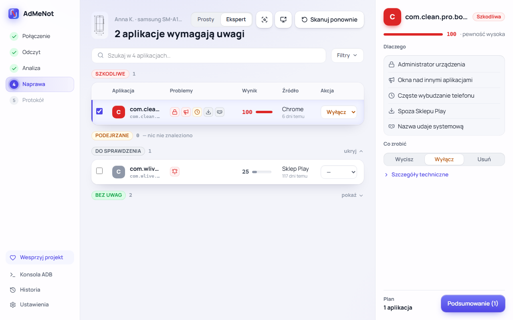
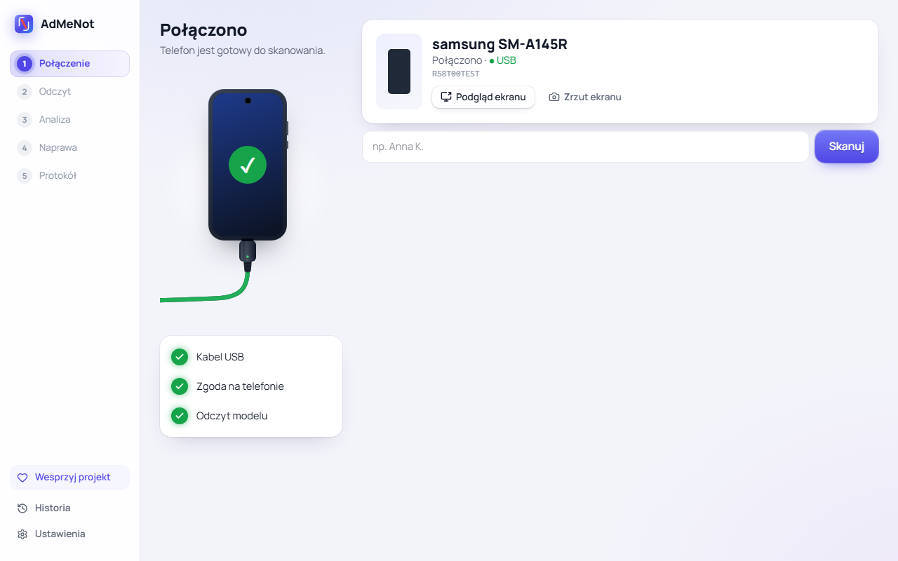
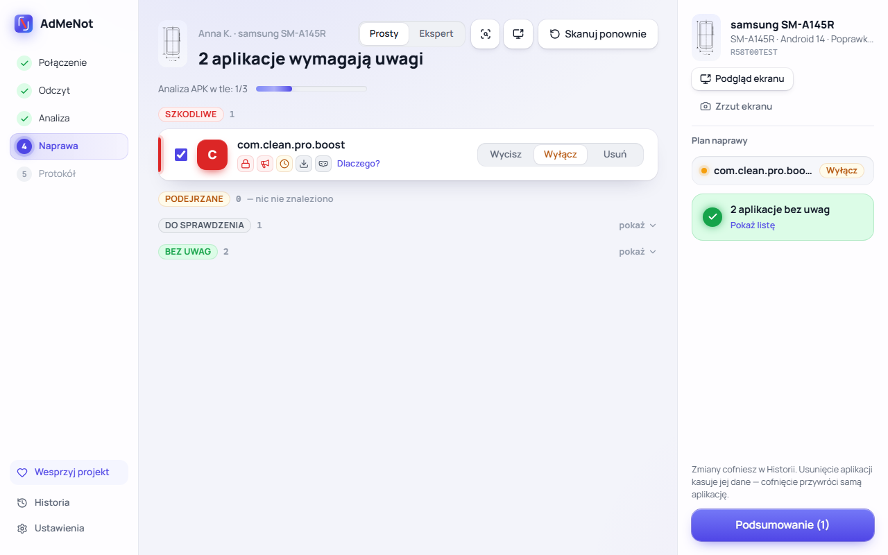
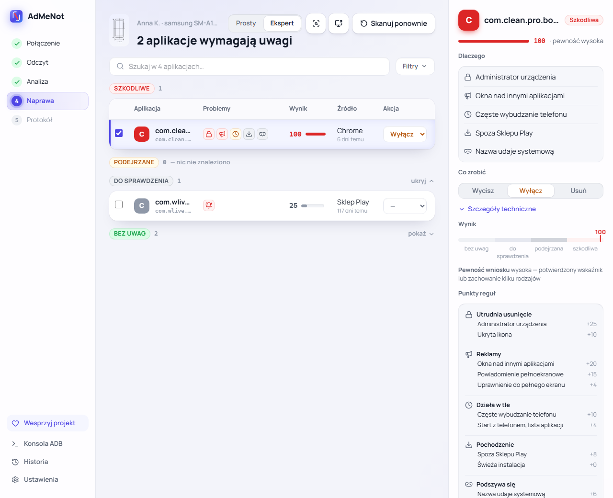
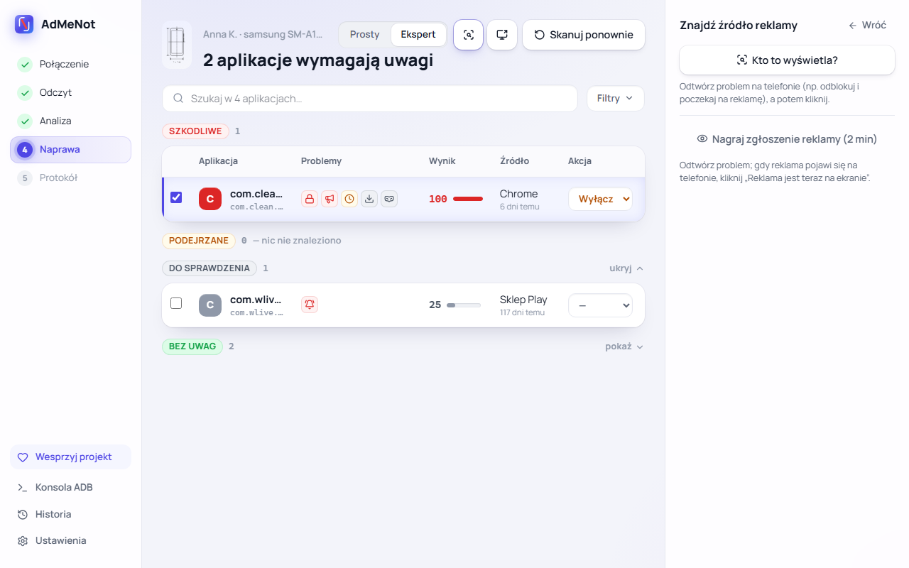
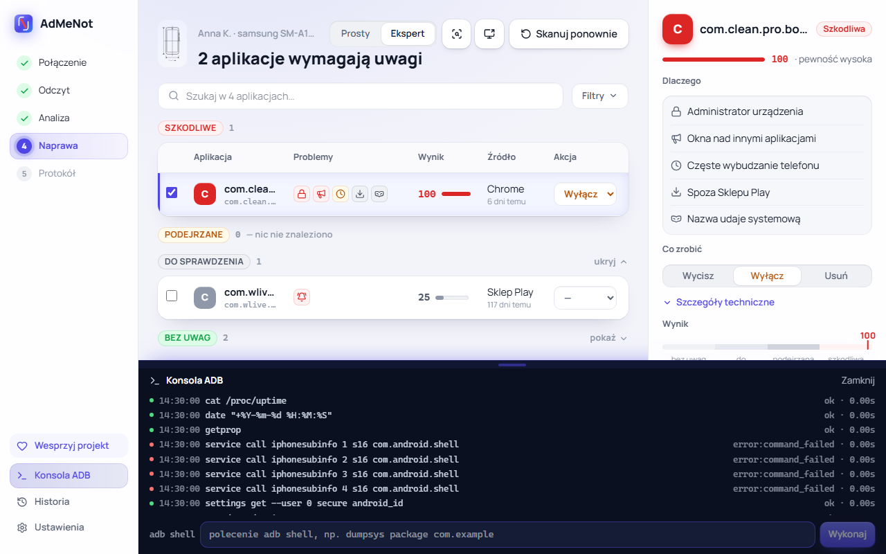
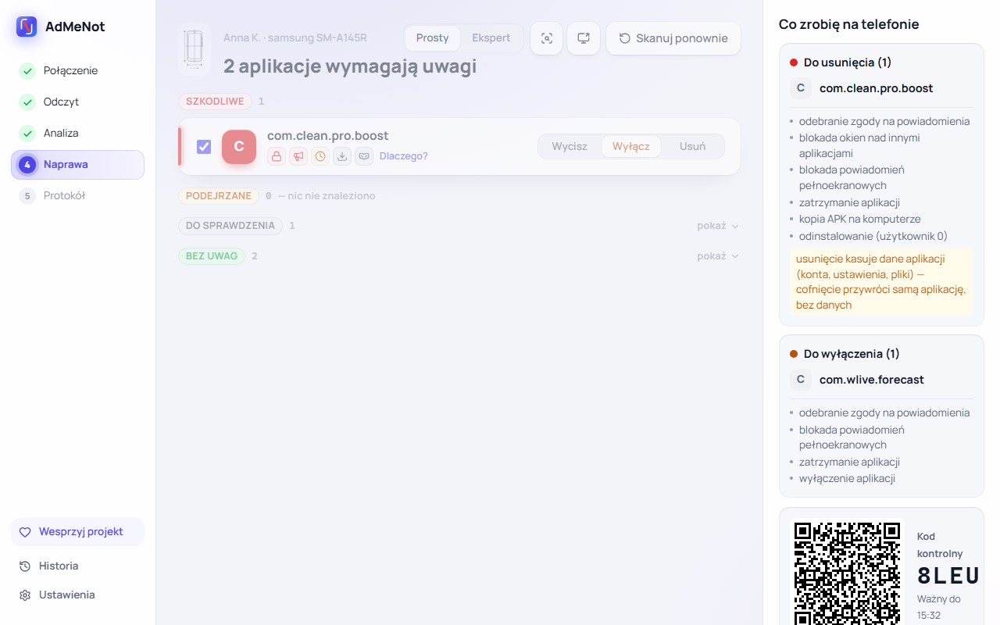
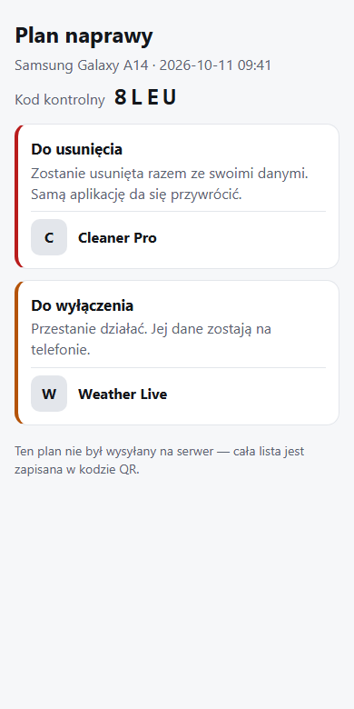
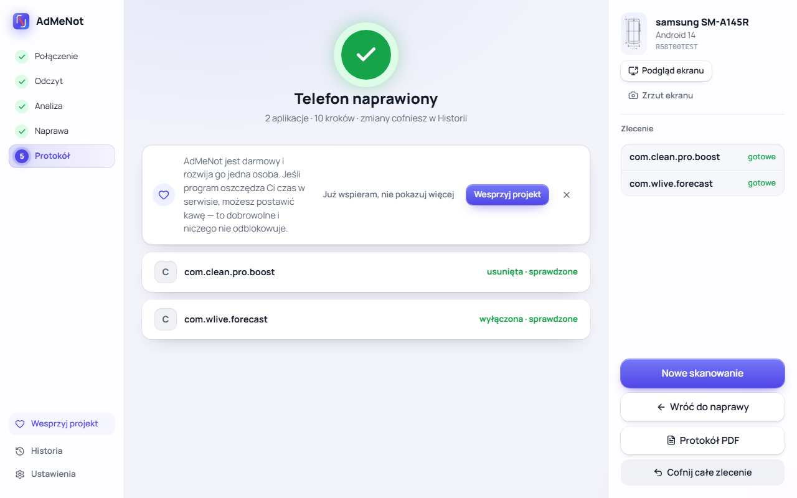
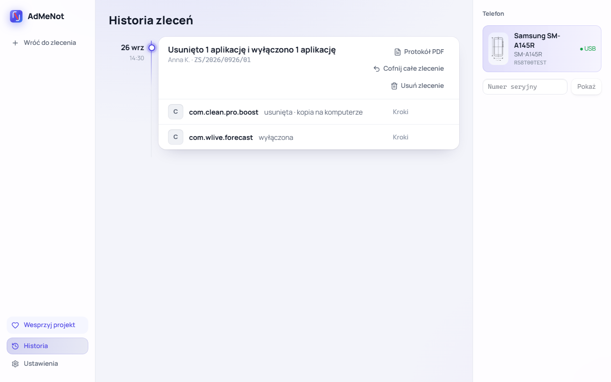

<h1>&nbsp;AdMeNot</h1>

[English](README.md) | **Polski**

**Darmowy program na Windows dla serwisów telefonów, który usuwa adware z Androida.** Podłączasz telefon kablem USB: AdMeNot znajduje aplikacje, które wyświetlają reklamy nad innymi aplikacjami, zasypują telefon powiadomieniami albo bronią się przed usunięciem, wyjaśnia, dlaczego każda z nich została oznaczona, i wycisza, wyłącza albo usuwa je — z możliwością cofnięcia.

[Pobierz na Windows](https://github.com/PerlessMtFuji/AdMeNot/releases/latest) · [Strona](https://admenot.perlessmtfuji.workers.dev/pl/) · [Wesprzyj projekt](https://suppi.pl/perlessmtfuji)

<picture>
  <source media="(prefers-color-scheme: dark)" srcset="docs/img/pl/results-expert-dark.png">
  
</picture>

> Publiczna beta. Oceny są heurystyczne: mówią, co aplikacja robi i jak pewny jest program, a nie że to wirus. Ostatnie słowo ma serwisant — zanim im zaufasz, przeczytaj [Fałszywe alarmy](#fałszywe-alarmy).

## Spis treści

- [Co potrafi](#co-potrafi)
- [Jak oceniane są aplikacje](#jak-oceniane-są-aplikacje)
- [Fałszywe alarmy](#fałszywe-alarmy)
- [Instalacja](#instalacja)
- [Rozwój](#rozwój)
- [Wsparcie](#wsparcie) · [Licencja](#licencja)

## Co potrafi

### Podłączenie i skan

Podłącz telefon z włączonym debugowaniem USB. AdMeNot rozpoznaje model (ze zdjęciem z bazy telefonów), odczytuje zainstalowane aplikacje i to, co robiły na telefonie przez ostatnią dobę, a potem — w tle — kopiuje i analizuje pliki APK aplikacji użytkownika. Skan niczego na telefonie nie zmienia.

 

### Wyniki w dwóch trybach

- **Prosty** — aplikacje w grupach *Szkodliwe*, *Podejrzane*, *Do sprawdzenia* i *Bez uwag*, każda z ikonami problemów i zrozumiałym „Dlaczego?”.
- **Ekspert** — tabela z wynikiem, źródłem i wiekiem instalacji, wyszukiwarką i filtrami oraz pełną listą punktów reguł i pewnością wniosku dla każdej aplikacji.

### Znajdź źródło reklamy

Gdy klient mówi „wyskakują reklamy”, a winowajca nie jest oczywisty, wywołaj problem na telefonie i kliknij **Kto to wyświetla?** — AdMeNot odczyta, do której aplikacji należy okno na ekranie. **Nagraj zgłoszenie reklamy** obserwuje telefon przez dwie minuty; klikasz, gdy pojawi się reklama, a aplikacja za nią dostaje dodatkowy sygnał w ocenie. Ekran telefonu można podejrzeć na komputerze (scrcpy), a zrzuty ekranu dołączyć do zlecenia.

 

**Konsola ADB** pokazuje każde polecenie, które program wysyła do telefonu.

### Plan naprawy, pokazany klientowi

Każda aplikacja dostaje jeden z trzech poziomów: **Wycisz** (odebranie powiadomień, blokada okien nad innymi aplikacjami i powiadomień pełnoekranowych), **Wyłącz** (dodatkowo zatrzymanie i wyłączenie aplikacji) albo **Usuń** (kopia APK na komputerze, potem odinstalowanie). Podsumowanie pokazuje każdy krok, zanim cokolwiek się wykona. **Pokaż klientowi** umieszcza plan w kodzie QR z kodem kontrolnym: klient otwiera go na swoim telefonie, a ten sam kod widzi serwisant na ekranie.

 

Plan jest przechowywany zaszyfrowany na serwerze AdMeNot przez godzinę i odczyta go tylko klucz z kodu QR; bez internetu cały plan trafia do samego kodu QR.

### Naprawa, protokół i cofanie

AdMeNot wykonuje kroki i sprawdza każdy z nich. Administrator urządzenia wymaga jednego ruchu na telefonie — program mówi jakiego. Gdy kabel wypadnie w trakcie naprawy, po ponownym podłączeniu zlecenie da się dokończyć albo cofnąć. Zakończone zlecenie dostaje protokół serwisowy w PDF z nazwą i logo serwisu oraz zrzutami ekranu.

 

Każdą zmianę cofniesz w **Historii**: wyłączona lub wyciszona aplikacja wraca do poprzedniego stanu, usunięta jest instalowana z kopii. Usunięcie kasuje dane aplikacji (konta, ustawienia, pliki) — cofnięcie przywraca samą aplikację, bez danych.

### Poza tym

- Polski i angielski, jasny i ciemny motyw (zgodnie z Windows).
- Chronione aplikacje systemowe (Ustawienia, telefon, interfejs systemu, instalator…) są zablokowane — tryb ekspercki odblokowuje taką aplikację dopiero po wpisaniu nazwy pakietu. Aktywną klawiaturę da się wyciszyć, ale nie wyłączyć, a launcher jest zastępowany tylko launcherem producenta.
- Aktualizacje są sprawdzane automatycznie; anonimowe statystyki są wyłączone, dopóki ich nie włączysz przy pierwszym uruchomieniu.

## Jak oceniane są aplikacje

Każda aplikacja dostaje **wynik od 0 do 100** i **pewność wniosku** (niska / średnia / wysoka). Werdykt zależy od obu. Reguły są w [`rules.yaml`](src/admenot/engine/rules/data/rules.yaml) i [`python_rules.py`](src/admenot/engine/rules/python_rules.py), arytmetyka w [`scoring.py`](src/admenot/engine/scoring.py). Liczby poniżej dotyczą wersji 0.9.2.

### 1. Sygnały

Sygnał to reguła, która pasuje. Każdy sygnał należy do jednej **klasy** i ma podstawę — siłę dowodu: aplikacja coś *deklaruje* w pakiecie, ma do tego *ścieżkę w kodzie*, *dostała* dostęp, *zaobserwowano*, że to robi na tym telefonie, albo pasuje do *potwierdzonego* wskaźnika zagrożenia.

**Zachowanie** — zaobserwowane na telefonie w ostatniej dobie (statystyki użycia, app ops, powiadomienia, alarmy):

| Reguła | Sygnał | Punkty |
|---|---|---|
| DM-NOTIF-01 | 8–19 powiadomień przerywających na godzinę (dźwięk, wibracja lub wyskakujące) | 15 |
| DM-NOTIF-02 | 20 i więcej na godzinę | 25 |
| DM-NOTIF-03 | seria: 30+ w ciągu godziny przy niskiej średniej dobowej | 15 |
| DM-OVERLAY-01 | wyświetlała okna nad innymi aplikacjami w ostatniej dobie | 20 |
| DM-FSI-01 | wysłała powiadomienie pełnoekranowe | 15 |
| DM-ALARM-01 | budzi telefon 6+ razy na godzinę (aplikacje użytkownika) | 10 |
| DM-BGACT-01 | wychodziła na pierwszy plan zaraz po odblokowaniu, 3+ razy w dobie | 12 |
| DM-INCIDENT-01 | jej okno było na ekranie, gdy serwisant zaznaczył reklamę | 5 |

**Pozycja** — dostęp, który daje aplikacji dużą władzę albo utrudnia usunięcie:

| Reguła | Sygnał | Punkty |
|---|---|---|
| DM-ADMIN-01 | administrator urządzenia | 25 |
| DM-A11Y-01 | włączona usługa ułatwień dostępu | 20 |
| DM-NLS-01 | odczytuje powiadomienia | 10 |
| DM-HIDDEN-01 | brak ikony w menu (aplikacje użytkownika) | 10 |

**Kontekst** — pochodzenie i deklaracje (aplikacje użytkownika):

| Reguła | Sygnał | Punkty |
|---|---|---|
| DM-SRC-01 | zainstalowana spoza Sklepu Play | 8 |
| DM-HOME-01 / 02 | jest ekranem głównym / może go zastąpić | 8 / 4 |
| DM-SMS-01, DM-BROWSER-01 | domyślna aplikacja SMS / domyślna przeglądarka | 8 / 4 |
| DM-LABEL-01 | niewidoczne znaki w nazwie aplikacji | 8 |
| DM-NAME-01 | nazwa pakietu z „system”, „cleaner”, „booster”, „security”… (spoza Play) | 6 |
| DM-NAME-02 | losowo wyglądająca nazwa pakietu (spoza Play) | 5 |
| DM-PERM-01 | startuje z telefonem i odczytuje listę aplikacji | 4 |
| DM-FSIPERM-01 | może wyświetlać powiadomienia pełnoekranowe (spoza Play) | 4 |
| DM-FRESH-01 | zainstalowana w ciągu 14 dni — pokazywane, ale warte 0 | 0 |

**APK** — z pliku aplikacji (aplikacje użytkownika):

| Reguła | Sygnał | Punkty |
|---|---|---|
| DM-ADSDK-02 / 01 | 5 i więcej sieci reklamowych w kodzie / 1–4 | 25 / 3 |
| DM-CODE-* | ścieżki w kodzie: otwiera ekran przy starcie, przełącza własne komponenty, dodaje okna, ładuje kod | po 5 |
| DM-DYNDEX-01 | deklaruje ładowanie dodatkowego kodu | 3 |

**Wskaźniki zagrożeń (IOC)** — skrót pliku APK albo certyfikat podpisujący jest w [bazie potwierdzonych zagrożeń](src/admenot/engine/apk/data/iocs.yaml), a każdy wpis opiera się na publicznym raporcie: 80 (skrót pliku), 60 (certyfikat używany tylko do szkodliwych aplikacji), 30 (certyfikat wspólny ze znanymi próbkami — nie liczy się jako potwierdzenie). W obecnej wersji baza jest pusta, więc żaden werdykt jeszcze od niej nie zależy.

### 2. Od sygnałów do wyniku

1. **Jeden mechanizm liczy się raz.** Sygnały o tym samym na różnych poziomach (np. „kod dodaje okno” i „wyświetlała okna nad innymi”) tworzą grupę; liczy się tylko najsilniejszy.
2. **Każda klasa ma limit**, żeby jeden rodzaj dowodu nie przesądzał sam: zachowanie ≤ 60, pozycja ≤ 40, kontekst ≤ 20, APK ≤ 30, IOC ≤ 100.
3. **Kombinacje** dodają premię — najwyżej jedną, największą:
   - bez ikony + spoza Play + okna nad innymi aplikacjami: **+20**
   - administrator urządzenia spoza Play, który wyświetla treści (okna, powiadomienia): **+15**
   - 5+ sieci reklamowych i zachowanie reklamowe na telefonie: **+15**
4. Suma jest ograniczona do 100.
5. **Zaufane aplikacje** (z [listy zaufanych](src/admenot/engine/allowlist/data/trusted.yaml), z pasującym certyfikatem podpisującym) zachowują tylko zachowanie i potwierdzone wskaźniki — sygnały tożsamości przestają się liczyć, ale to, co aplikacja robi, liczy się nadal.
6. **Aplikacje systemowe** bez zaobserwowanego zachowania mają wynik najwyżej 24, czyli zawsze *Bez uwag*.

### 3. Pewność wniosku

Pewność mówi, na czym opiera się wynik, a nie jak jest wysoki:

- **wysoka** — potwierdzony wskaźnik albo zaobserwowane zachowanie co najmniej dwóch różnych rodzajów (np. reklamy i działanie w tle) przy pełnych danych;
- **średnia** — jakieś zaobserwowane zachowanie;
- **niska** — tylko deklaracje, uprawnienia i kod.

Dane są niepełne, gdy telefon jest włączony krócej niż 6 godzin, statystyki użycia obejmują mniej niż 6 godzin albo nie udał się odczyt zachowania. Wyniki to wtedy pokazują, a pewność nie może być wysoka.

### 4. Werdykt

| Werdykt | Warunek | Domyślnie zaznaczone |
|---|---|---|
| **Szkodliwa** | wynik ≥ 75 **i** wysoka pewność | Wyłącz |
| **Podejrzana** | wynik ≥ 50 (albo ≥ 75 bez wysokiej pewności) | Wyłącz; Wycisz przy niskiej pewności |
| **Do sprawdzenia** | wynik ≥ 25 | nic — decyduje serwisant |
| **Bez uwag** | wynik < 25 | nic |

Usunięcie nigdy nie jest zaznaczane domyślnie, bo kasuje dane aplikacji. Bez potwierdzonego wskaźnika werdykt *Szkodliwa* wymaga co najmniej dwóch rodzajów zachowania zaobserwowanych na tym telefonie — same uprawnienia i kod kończą się na *Podejrzana*.

### Przykład

Aplikacja ze zrzutów powyżej:

| Klasa | Sygnały | Suma → po limicie |
|---|---|---|
| Zachowanie | okna nad aplikacjami 20 + powiadomienie pełnoekranowe 15 + wybudzanie 10 | 45 → 45 |
| Pozycja | administrator urządzenia 25 + ukryta ikona 10 | 35 → 35 |
| Kontekst | spoza Play 8 + nazwa udaje systemową 6 + start z telefonem i lista aplikacji 4 + uprawnienie do pełnego ekranu 4 + świeża instalacja 0 | 22 → 20 |
| Kombinacja | bez ikony + spoza Play + okna nad aplikacjami | +20 |
| **Razem** | | 120 → **100** |

Zachowanie dwóch rodzajów (reklamy i działanie w tle) przy pełnych danych daje wysoką pewność, więc werdykt to **Szkodliwa**. Aplikacja pogodowa obok wysyła 20+ powiadomień na godzinę: 25 punktów z samego zachowania — *Do sprawdzenia*, nic nie jest zaznaczone.

## Fałszywe alarmy

Ocena opisuje, co aplikacja robi, a nie czym jest. Legalne aplikacje też zbierają punkty:

- **Komunikatory i aplikacje społecznościowe** — dymki czatu to okna nad innymi aplikacjami (20), a aktywne czaty grupowe przekraczają 20 powiadomień na godzinę (25): 45 punktów, *Do sprawdzenia*.
- **Kontrola rodzicielska, aplikacje antykradzieżowe i służbowe (MDM)** — administrator urządzenia (25), ułatwienia dostępu (20), okna nad innymi aplikacjami (20), często ukryta ikona. Kilka takich sygnałów potrafi dać *Podejrzana*.
- **Automatyzacja, menedżery haseł, narzędzia ułatwień dostępu** (np. Tasker, MacroDroid, czytniki ekranu) — ułatwienia dostępu (20), dostęp do powiadomień (10), okna nad innymi.
- **Alternatywne launchery** — ekran główny (8) i częste okna nakładane.
- **Aplikacje spoza Sklepu Play** — F-Droid, APKMirror i wszystkie aplikacje na telefonach bez usług Google (np. nowsze Huawei) dostają „spoza Play” (8). Z nazwą typu „cleaner” albo „security” (6) albo losowo wyglądającą nazwą pakietu (5) kontekst szybko dochodzi do limitu 20.
- **Darmowe aplikacje i gry ze Sklepu Play** często mają pięć i więcej sieci reklamowych (25) — samo to daje *Do sprawdzenia*.
- **Fabryczne aplikacje producenta**, które naprawdę wyświetlają treści na ekranie blokady albo powiadomienia, są oceniane po zachowaniu jak każda inna aplikacja.

Co ogranicza szkody:

- Skan niczego nie zmienia i nic nie dzieje się bez potwierdzenia serwisanta. *Do sprawdzenia* nigdy nie jest zaznaczane domyślnie, usunięcie też nie.
- *Szkodliwa* wymaga wysokiej pewności: bez potwierdzonego wskaźnika — dwóch rodzajów zachowania zaobserwowanego na tym telefonie.
- Każdy powód jest pokazany z punktami, więc serwisant może sprawdzić, czy się zgadza („czy klient używa dymków Messengera?”).
- Każdą zmianę da się cofnąć; przed usunięciem powstaje kopia APK.
- Lista zaufanych usuwa sygnały tożsamości dla sprawdzonych aplikacji, ale jest krótka — większość legalnych aplikacji przechodzi przez te same reguły.

Zdarza się też odwrotnie: przy krótkim czasie pracy telefonu albo małej ilości danych adware, które w ostatniej dobie się nie ujawniło, może dostać niski wynik. Gdy klient nadal widzi reklamy, użyj **Znajdź źródło reklamy**, kiedy reklama jest na ekranie.

Błędna ocena? Załóż [zgłoszenie](https://github.com/PerlessMtFuji/AdMeNot/issues) z nazwą pakietu, powodami z trybu eksperckiego i informacją, skąd pochodzi aplikacja. Jeśli włączysz anonimowe statystyki (z nazwami pakietów), program wysyła też, którymi oznaczonymi aplikacjami zajęli się serwisanci, a które dodali ręcznie — tak dostrajane są reguły.

## Instalacja

Pobierz instalator z [Releases](https://github.com/PerlessMtFuji/AdMeNot/releases/latest) (Windows 10/11 x64, bez uprawnień administratora). Włącz w telefonie debugowanie USB (Opcje programisty) i podłącz go kablem. Instalator nie jest jeszcze podpisany cyfrowo, więc SmartScreen może ostrzec: kliknij **Więcej informacji**, potem **Uruchom mimo to**. Przy każdym wydaniu jest suma SHA-256 instalatora i wynik VirusTotal.

## Rozwój

### Wymagania

- Windows 10/11 x64, Python 3.13, Node.js 24 (tylko do budowania UI)
- `adb.exe` jest dołączany razem ze scrcpy (`scripts\fetch_tools.py`); inny adb można wskazać w ustawieniach
- Microsoft Edge WebView2 Runtime (wbudowany w Windows 11)

### Instalacja (środowisko deweloperskie)

    py -3.13 -m venv .venv
    .venv\Scripts\pip install -e ".[dev,gui,release]"
    python scripts\build_phone_db.py            # baza telefonów i zdjęcia
    python scripts\fetch_tools.py               # scrcpy 4.1 z adb (podgląd ekranu)
    powershell -ExecutionPolicy Bypass -File scripts\build_ui.ps1
    python scripts\build_icons.py               # tylko po zmianie assets\icon\*.svg (PNG, ICO, kopia dla UI)

### Uruchomienie GUI

    .venv\Scripts\admenot gui

albo `.venv\Scripts\admenot-gui`. Okno wymaga zbudowanego UI (`src\admenot\app\web\`, poza gitem) — bez niego program wypisze polecenie budowania.

Motyw (Systemowy / Jasny / Ciemny), język i domyślny tryb zmienia się w Ustawieniach; „Systemowy” podąża za motywem Windows.

Praca nad samym UI, bez telefonu i Pythona (atrapa mostu odtwarza nagrane scenariusze):

    cd ui
    npm run dev          # http://localhost:5173/?scenario=adware|clean|disconnect|unauthorized|many|empty (&lang=en)

### CLI

    admenot devices | device | scan [--apk] | capture | fix | undo | resume | history | cache | service | report | screenshot | selfcheck | gui

- `service` — zapisuje dane serwisu (nazwa, adres, telefon, logo) do protokołu, np. `admenot service --name "…"`.
- `report` — tworzy protokół serwisowy (PDF i HTML) dla zlecenia z dziennika, np. `admenot report --order ZS/…`.
- `screenshot` — zrzut ekranu telefonu: `--order ZS/…` zapisuje go w zleceniu (trafia do protokołu), `--out plik.png` zapisuje tylko plik.
- `selfcheck` — sprawdza, czy program ma wszystkie pliki (dane, narzędzia, UI); `--device --reference plik` porównuje skan telefonu z wynikiem `scan --apk --all`.

### Wydanie

    .venv\Scripts\python scripts\build_release.py [--device]

Tworzy `dist\release\AdMeNot-<wersja>-setup.exe` (instalacja dla użytkownika, bez uprawnień administratora). Numer wersji jest tylko w `src\admenot\__init__.py`. Pełna procedura i lista kontrolna: `docs/release.md`.

### Testy

    .venv\Scripts\python -m pytest
    .venv\Scripts\python -m ruff check src tests
    cd ui; npm test; npm run check; npm run e2e

Po zmianie mostu (`src/admenot/app/`) odśwież nagrania scenariuszy dla UI:

    .venv\Scripts\python scripts\record_bridge_fixtures.py

Zrzuty ekranu w tym README powstają z tych nagrań: `cd ui; npm run readme-shots` (zapisuje `docs/img/`).

### Dane użytkownika

`%LOCALAPPDATA%\AdMeNot\`: `settings.json`, `journal.db`, `backups\`, `logs\` (log sesji ADB i `app-*.log` z błędami okna), `phone_overrides.json`.

### Znane ograniczenia

- Porzucona analiza APK w tle (np. przez kliknięcie „Napraw” w jej trakcie) może jeszcze dokończyć do dwóch zaczętych, tylko-do-odczytu poleceń `adb pull` — nigdy nie dotykają dziennika, ale mogą pojawić się jako dodatkowe linie w konsoli ADB, już po starcie nowego zlecenia.
- Okno GUI, gdy jest otwarte, serwuje zbudowany UI z własnego lokalnego serwera statycznego na `127.0.0.1` (efemeryczny port; wywołania `js_api` nie idą przez HTTP).

## Wsparcie

AdMeNot jest darmowy i rozwija go jedna osoba. Jeśli oszczędza Ci czas, możesz go dobrowolnie wesprzeć na **[suppi.pl/perlessmtfuji](https://suppi.pl/perlessmtfuji)** (BLIK, przelew; więcej na [stronie wsparcia](https://admenot.perlessmtfuji.workers.dev/pl/donate)). Wsparcie niczego nie odblokowuje — program działa tak samo dla wszystkich.

## Licencja

AdMeNot jest darmowy i udostępniony na licencji [PolyForm Shield 1.0.0](LICENSE). Możesz go używać, także zarobkowo — np. w serwisie przy naprawie telefonów klientów. Nie wolno sprzedawać programu ani na bazie tego kodu udostępniać produktu, który z nim konkuruje. To kod jawny (source-available), a nie open source w rozumieniu OSI. Licencje składników innych autorów są w `THIRD_PARTY_NOTICES.txt` w katalogu zainstalowanego programu.
